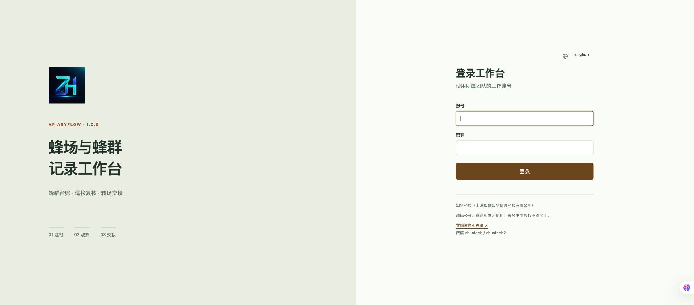
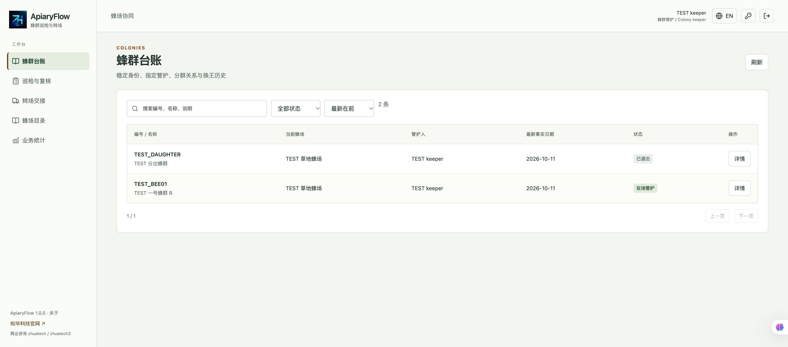
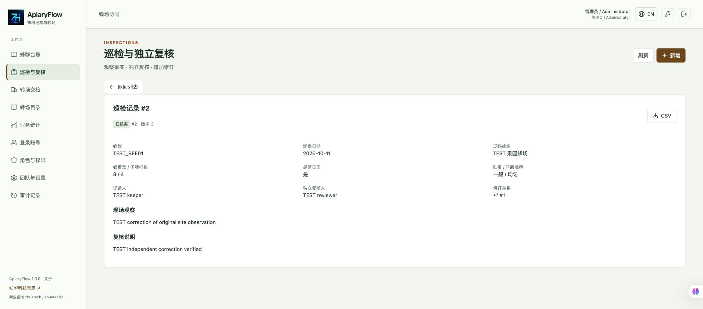
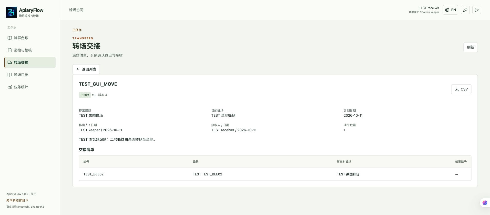
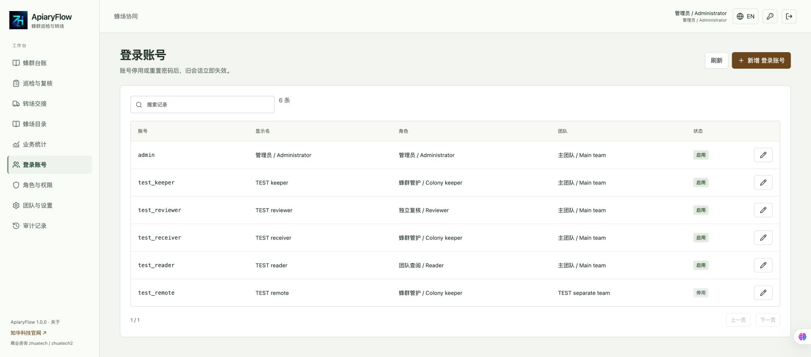
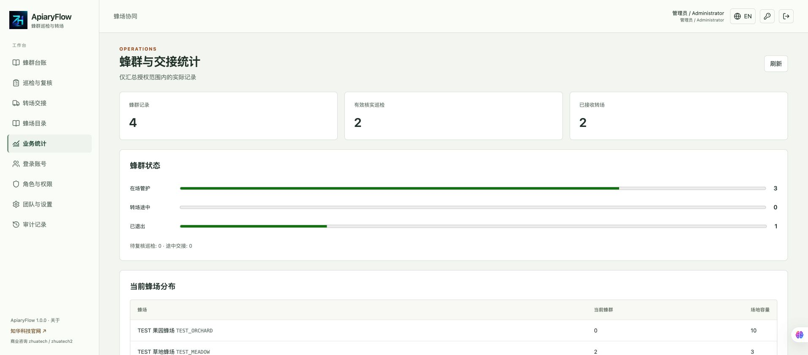
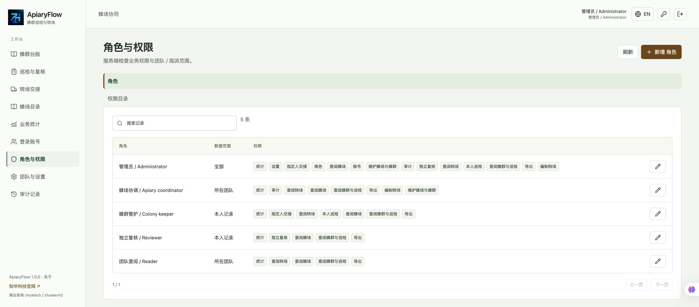

# ApiaryFlow · Colony Inspections and Apiary Transfers

[中文](README.md) | [English](README.en.md)


**Source available for personal non-commercial learning** from ZhiHua Technology (Shanghai Rujing Zhihua Information Technology Co., Ltd.). Java 21, Spring Boot, Vue 3 and MySQL 8.4 connect colony identity, inspected observations, recorded splits and two-person apiary handovers. Website: [https://www.zhuatech.cn/](https://www.zhuatech.cn/). Commercial use requires written authorization.

## Continuous history across locations

A colony can change location while its identity and verified observations remain stable. ApiaryFlow separates permanent colony codes from current apiary location, retaining assigned keepers, queen changes, split relationships, independent review, physical departure and receipt. Intended for small beekeeping teams and educational practice evaluating a shared record workflow in non-commercial settings.

The system records facts and descriptive counts. **It does not diagnose disease, recommend treatments or husbandry, certify honey quality, or submit statutory records.** Actual observations and field operations remain the responsibility of appropriately qualified people.

## Implemented workflow

1. Coordinators register apiaries, team ownership, location descriptions and capacity; colonies have stable codes, sources, species categories and assigned keepers.
2. Only the current assigned keeper records an inspection: date, frames covered, brood frames, queen seen, stores, brood pattern and notes, with a designated independent reviewer.
3. Submission freezes the colony, apiary and queen context. The reviewer verifies or returns the record; the keeper may withdraw or cancel a draft.
4. Verified observations cannot be edited or deleted. A correction creates another record referencing the original, retaining its observation date and original location. Previous records, digests and original CSV remain available.
5. A split registers a new colony identity linked to its parent; the parent stays active. Queen-change events retain old/new codes and dates. Retiring a colony preserves history.
6. A same-team transfer includes origin, destination, 1–50 colonies and different assigned sender and receiver.
7. Release freezes the manifest and reserves colonies and destination capacity. Only the assigned sender confirms departure; only the assigned receiver confirms receipt. Current location changes on receipt.
8. Released transfers can be cancelled before departure, releasing reservations. In-transit transfers cannot be cancelled or presumed received. Reserved/in-transit colonies cannot be inspected, requeened, split or booked into another transfer.

| Workspace | Implemented capabilities |
| --- | --- |
| Colonies | Registration, versioned maintenance, deletion of never-used erroneous registrations, assigned keepers, sources, categories, locations, split links, queen and retirement events |
| Inspections | Own records, independent assigned review, return/withdraw/cancel, context snapshots, append corrections, original/replacement links and CSV |
| Transfers | Drafts, release, destination and exclusive colony reservations, assigned departure/receipt, dates, cancellation, frozen manifest and CSV |
| Apiaries | Stable identity, team, location, capacity and enable/disable; resident/reservation references prevent unsafe capacity reductions or disabling |
| Reports | Authorized colony states, current verified observations, pending reviews, received/in-transit transfers and current apiary distribution |
| Administration | Accounts, roles, permissions, teams/IANA zones, menus, species dictionary, capacity parameters, audit and last full administrator protection |

User and management interfaces use actual server persistence. Search codes/names/notes, filter states, sort and page results, view details and edit forms. Chinese, English and mobile layouts are provided; there is no frontend-only simulated success mode.

## Roles and limits

- Coordinators use team scope; apiary/colony management requires Team or All scope. Keepers default to Own/Assigned scope. Reviewers default to assigned observations.
- Only the current assigned keeper records inspections. Reviewers cannot verify their own observations. Administrators cannot substitute for assigned reviewers, senders or receivers.
- Account/team disabling, role changes and password resets are checked on subsequent requests. Team data is isolated; cross-team transfers are unimplemented.
- A split link records a declared source relationship, not genetic identification.
- Actual dates support2000–2100 and cannot exceed today in the team's IANA zone. Ordinary facts cannot precede existing entity business dates. Planned transfers may be future; departure cannot precede plan and receipt cannot precede departure. Corrections retain original observation dates.
- Frame counts are integers0–200; brood frames cannot exceed frames covered. Unknown observations are explicit and do not generate diagnoses.
- Released incoming reservations count toward capacity. In-transit colonies retain origin until received. Own-scope apiary counts cover visible colonies, not total site occupancy.
- Accounts, roles, teams and core business records check versions. Menus, dictionaries and parameters serialize writes with the last saved value taking effect. Transactions serialize writes. This is a single-instance, low-volume collaboration system, not a high-throughput multi-tenant SaaS. Retained-record limits100–1000 do not delete history.

**Unimplemented:** partial receipt, transport exception handling, offline sync, maps/location tracking, IoT, NFC, attachments, automatic alerts, AI, diagnosis/treatment, harvest batches, sales, inventory, finance and external service integrations. No external business accounts, API keys or paid services are required.

## Current running pages

Screenshots show explicitly labelled fictitious TEST inputs in an isolated acceptance instance, not customer cases.















[Colony timeline and splits](docs/screenshots/08-timeline.jpg) · [English interface](docs/screenshots/09-english.jpg) · [Mobile](docs/screenshots/10-mobile.jpg)

## Architecture and files

Browser → Nginx same-origin proxy → Spring Security session/CSRF → transactional services/JPA → MySQL. Flyway manages V1identity and V2business schema; Hibernate validates rather than recreates tables. SHA256 snapshot digests do not resist database administrator tampering and are not legal signatures or compliance certification.

```text
backend/       Java 21 / Spring Boot4.0.7 / Security / JPA / Flyway
frontend/      Vue 3.5.43 / Vite8.1.5 / bilingual business and admin views
scripts/       private configuration, live business checks, backup/new restore
docs/          boundaries, architecture, API, operations, deployment and screenshots
compose.yaml   MySQL 8.4 + backend + Nginx frontend
LICENSE        custom non-commercial source license
NOTICE         third-party license boundaries
```

Requires Docker Engine and Compose v2, Python 3.10+. Source development also requires JDK 21, Maven 3.9+, Node.js 24.19.0+ and npm. Images use Temurin21, Node24.19.0, MySQL 8.4 and Nginx1.29. Initial builds need official image registries, Maven Central and npm.

## Install, initialize and run

```bash
python3 scripts/init-env.py
docker compose config --quiet
docker compose up --build -d --wait
```

UI: [http://127.0.0.1:8134/](http://127.0.0.1:8134/). Health: [http://127.0.0.1:8134/actuator/health](http://127.0.0.1:8134/actuator/health). Localhost binding is the default; database/backend ports are not mapped to the host.

The initial username is configured by `ADMIN_USERNAME`, default `admin`. The script generates unique random passwords in a local0600 `.env`; privately inspect `ADMIN_PASSWORD`. **There is no shared default password.** Existing configuration cannot be overwritten; changing environment variables does not reset existing accounts.

An empty database runs `backend/src/main/resources/db/migration/V1__identity.sql` then `V2__apiary_workflows.sql`, initializes roles, menus, species categories, parameters and an administrator. Business tables start empty. Add independent keeper/reviewer/receiver accounts before registering apiaries and colonies. `scripts/smoke.py` creates labelled TEST records only in an isolated empty database.

For an occupied port:

```bash
WEB_PORT=18134 docker compose up --build -d --wait
```

For source development, prepare isolated MySQL 8.4 and inject `DATABASE_URL`, `DATABASE_USER`, `DATABASE_PASSWORD`, `ADMIN_PASSWORD` according to `.env.example` (Maven does not load `.env` automatically). Run `mvn spring-boot:run` in `backend`; run `npm ci` and `npm run dev` in `frontend`. The development proxy defaults to backend localhost8080; parallel projects need separate ports/proxy settings. Production frontend uses same-origin `/api`.

| Variable | Purpose |
| --- | --- |
| `MYSQL_ROOT_PASSWORD` | Bundled MySQL empty-volume initialization strong password |
| `DATABASE_PASSWORD` | Required unique application database password |
| `ADMIN_USERNAME` / `ADMIN_PASSWORD` | Empty identity database initialization, password12–72 UTF-8 bytes with upper/lowercase and digit |
| `WEB_PORT` / `BIND_ADDRESS` | Defaults8134 /127.0.0.1 |
| `COOKIE_SECURE` | false for local HTTP, true for deployed HTTPS |
| `DATABASE_URL` / `DATABASE_USER` | Optional external MySQL with unique credentials and trusted TLS |

Database `zhuatech_apiaryflow` persists in `mysql-data`. Versioned migrations define tables, indexes and foreign keys. Upgrade after private backup and validation in a separate new restore volume; never rewrite applied migrations or delete data instead of upgrading. [Deployment and restore](docs/deployment.md).

## Tests

```bash
mvn -B -f backend/pom.xml spotless:check clean verify
cd frontend
npm ci
npm run format:check
npm run lint
npm test
npm run build
# Return to repository root
python3 -m venv .venv
.venv/bin/python -m pip install -r scripts/requirements-quality.txt
.venv/bin/python -m black --check scripts
.venv/bin/python scripts/release-check.py
docker compose config --quiet
git diff --check
```

Backend tests cover input boundaries, full review/correction/transfer flow, original locations, capacity reservations, assigned persons, team isolation, CSRF, live disablement and versions. H2 integration tests must be supplemented by **an actual empty MySQL volume**. Docker Maven builds execute all tests. `python3 scripts/smoke.py --help` describes isolated `seed`, `capture`, `compare` modes; private state contains test passwords and must not be committed. [Acceptance results](docs/verification.md).

## Security, deployment and troubleshooting

Authorized deployment personnel must configure HTTPS, trusted proxies,`COOKIE_SECURE=true`, secure networks and private backups. HttpOnly/SameSite Strict cookies, BCrypt12, CSRF, live permissions, bounded inputs and fixed queries protect endpoints. Sessions are in memory; restarting requires login. No distributed identity service is provided. CSV neutralizes text formula prefixes and uses server-generated filenames rather than client paths. [Security](docs/security.md).

- Startup failure: inspect `docker compose logs backend`, required settings, database health and migrations; never skip failed tests.
- Inspection denied: verify assigned keeper, enabled account, colony state and transfer reservations.
- Review denied: use the assigned independent reviewer with matching team and current rights.
- Insufficient capacity: residents and released incoming reservations count. To release a reservation, cancel its released transfer before departure.
- Receipt denied: assigned sender must depart before the assigned receiver receives.
- Date/version conflict: refresh and verify current records. Network interruptions leave submission result unknown; writes are not automatically retried.
- Incorrect verified observation: append a correction with original date/location, preserving the old facts.

[Operations](docs/operations.md) · [Business boundaries](docs/business.md) · [API](docs/api.md) · [Architecture](docs/architecture.md)

## License, contributions and contact

Self-owned code uses [LICENSE](LICENSE): personal learning, technical research and non-commercial exchange only. Commercial use, paid delivery/deployment, resale, commercial training and enterprise customization require prior written authorization from Shanghai Rujing Zhihua Information Technology Co., Ltd. This is not MIT/Apache or an OSI open-source license. Third-party components retain their licenses; see [NOTICE](NOTICE). Provided as-is without guarantees of observation truth, husbandry outcomes, food safety or production suitability.

ZhiHua Technology (Shanghai Rujing Zhihua Information Technology Co., Ltd.) provides this source-available learning edition. Enterprise digitization, deployment, integration, software outsourcing, implementation and customization are available through a separate authorized engagement. Website: <https://www.zhuatech.cn/>.

Submit sanitized Issues/PRs with reproduction, versions and tests; do not include customer locations, records or credentials. Report exploitable security issues privately through the following contacts rather than public Issues.

- Email: [han@zhuatech.cn](mailto:han@zhuatech.cn)
- Email: [jack@zhuatech.cn](mailto:jack@zhuatech.cn)
- WhatsApp: [+86 17521234993](https://wa.me/8617521234993)
