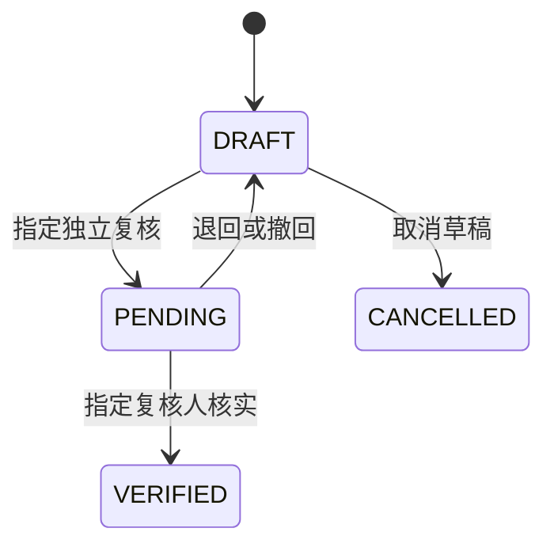
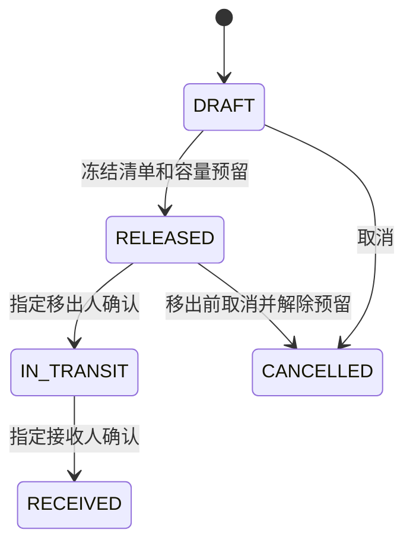

# ApiaryFlow 架构与记录口径 / Architecture

知华科技（上海如静知华信息科技有限公司）· https://www.zhuatech.cn/ · 微信 zhuatech / zhuatech2。

## 数据与边界 / Data

`account`、`access_role`、`permission`、`role_permission`、`department`、`nav_menu`、`dictionary_entry`、`system_setting`、`audit_event`由V1建立。V2建立`apiary_site`、`colony`、`inspection`、`colony_transfer`、`transfer_colony`、`colony_event`及外键和查询索引。

蜂群独立身份与位置分开。`parent_id`是创建新蜂群时保存的单向来源，只能指向已存在父群；界面不能修改，不产生递归循环。`queen_code`是录入编号，不是全系统认证标识，不保证不同养蜂人员编号唯一。历史事件保存业务身份及事实摘要。

Colony identity is independent of location. Parent links are immutable declared split sources, not genetic evidence. Queen codes are entered labels rather than globally authenticated identities. Events retain the actor, factual date and context.

## 状态 / States

核实后的巡检不进入编辑状态。修订另建记录，通过`supersedes_id`关联同蜂群且尚未被代替的核实记录，保持原观察日期与冻结蜂场／蜂王上下文。只有新记录核实后原记录才被标记为已修订；旧值和CSV不改变。未送审误建草稿可删除；已经送审又撤回的记录保留。独立复核人不能是观察记录人，账号仍须启用并有岗位权限。

Verified observations never return to editable state. Corrections append a record; the old record becomes superseded only when the correction is verified. Original date/location/queen context and original CSV remain intact. Withdrawn previously submitted records cannot be deleted. Reviewers must be independent, enabled and still authorized.

发布对每个蜂群写入`move_id`。移出后状态IN_TRANSIT但位置仍在原蜂场；接收后才改位置、恢复ACTIVE、清除预留。被预留及途中蜂群不能巡检、分群、换王或加入另一转场。容量核对包含未退出的当前位置居民和RELEASED／IN_TRANSIT接收预留，采取保守口径：尚未接收的移出蜂群仍占原场容量。

Release reserves each colony with a transfer ID. Departure changes state, not current location. Receipt atomically updates location, clears reservations and restores ACTIVE. Capacity includes current non-retired residents and released/in-transit incoming reservations. Departed-but-not-received residents conservatively occupy origin capacity.

## 并发、身份与摘要 / Concurrency and identity

每次请求检查账号、当前密码散列指纹、团队启用和当前角色；停用、重置密码及角色变化后旧权限不会继续生效。BCrypt12轮，CSRF保护所有写入，Cookie为HttpOnly/SameSiteStrict，30分钟内存会话。全部业务及目录写入先锁主团队行，随后清理持久化缓存，防止过期身份；账号、角色、团队及核心业务版本冲突返回409；菜单、字典、权限说明和参数串行保存，以最后保存者为准。低容量单实例设计，无分布式锁或高吞吐保证。

Every request checks live identity, password fingerprint, enabled team and role. Writes lock the main team row, clear stale entity state and enforce versions for accounts, roles, teams and core business. Other catalogues serialize writes with last-save semantics. This low-volume single-instance design does not promise distributed/high-throughput behavior.

SHA256校验应用JSON快照，应用不提供改写核实事实的接口，但数据库管理员可以修改数据和摘要，不能据此宣称不可篡改或法定签名。CSV从快照读取，逐业务列导出，文本前缀中和，保留准确日期和修订关系。账号散列不返回、业务导出不插入品牌广告。

Snapshot digests detect application-level mismatches, not database administrator tampering. CSV uses frozen context and business columns, neutralizes formula prefixes and does not add advertising. Password hashes are not returned.
